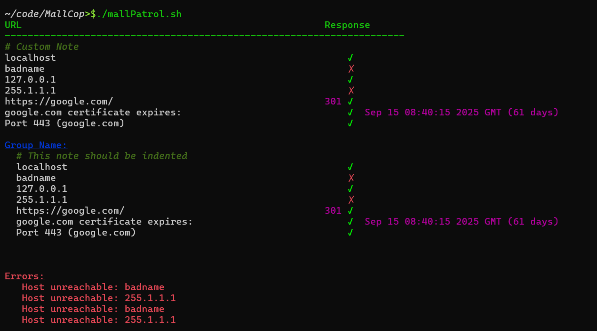

# Mall Cop

## Monitoring and Alerting by Loading from a List - Central Observation Process

This script reads a list of servers from a file (default is `urls.list`) and performs several common queries to  make sure the server is responding as expected.



## Usage

To use MallCop, download the latest version of `MallPatrol.sh` from this repo.
Create a `urls.list` file in the same folder as the script and add entries of servers to monitor using the [List File Options](#list-file-options) listed below.
Each entry should be on a separate line.
Also, be sure the file ends with one or more empty lines (or the last line will not be properly parsed).

Successful test will be marked with a `✓` mark.

If any errors were detected, the corresponding line will be marked with an `✗`.
The details of the error will also be provided in a summary at the end of the tests in an `Errors:` section.

### Command Line Arguments

- `-g, --group groupname` Only process entries within the specified group; may be repeated
- `-f, --file filename`   Specify an alternate file containing the list of URLs and services to check
- `-w, --wait target`     Wait for an IP/host/group to respond to ping (1x/sec). Press `q` to abort.
- `-d, --dns hostname`    Perform a one-off DNS resolution check for the specified host and exit
- `-l, --list`            List available group names in the selected list file and exit
- `-v`                    Increase verbosity; repeat to raise the level (`-v`=1, `-vv`=2, `-vvv`=3, ...)
- `-h, --help`            Display this help message and exit
- `--version`             Display the script version and exit
- `filename|groupname...` Specify one or more group names and/or a file name as positional arguments

Value options accept either `-g name` or `-g=name` (same for the long forms, e.g. `--group=name`).

If no arguments are provided, then the default list file (`urls.list`) will be used and all groups will be traversed.
The default file is looked up in the current directory first, then in the script's directory.

The exit code is the number of errors found (`0` when all checks pass).

Restrictions:

- `-d` cannot be combined with `-w`, `-l`, `-g`, or positional arguments.
- `-w` cannot be combined with `-l`, `-g`, or positional arguments.

Examples:

```bash
# Check two groups from an alternate list file
./mallPatrol.sh -f prod.list -g Web -g Database
./mallPatrol.sh prod.list Web Database

# One-off DNS check with per-NS-server failures shown
./mallPatrol.sh -v -d host.domain.net
```

### DNS Mode (`-d`)

Runs a single [`dns`](#dns) check for the given hostname without needing a list file.
Use `-v` to show NS servers that failed to resolve the host, or `-vv` to also show the ones that succeeded.

### Wait Mode (`-w`)

Use wait mode when you want MallPatrol to ping a target until it comes online.

- Pings once per second
- Shows target and running ping attempt count
- Press `q` to abort
- On success, rings terminal bell 3 times with 1.25 second delay between rings

Examples:

```bash
# Wait for a direct host/IP
./mallPatrol.sh -w host.domain.net
./mallPatrol.sh -w 10.1.2.3

# Wait using a group name from a list file
./mallPatrol.sh -w Production -f urls.list
```

Group resolution behavior:

- If `-w` target matches a group name, the script searches that group for pingable entries only (bare host/IP lines).
- Non-ping directives (`http`, `https`, `cert`, `port`, `up`, `disk`, `note`, `dns`) are ignored for `-w` group resolution.
- If matched group has zero pingable entries, command exits with error.
- If matched group has more than one pingable entry, command exits with error and requires explicit host/IP.

## List File Options

The following is a list of prefixes and options that are available for use in the list file provided to MallPatrol.

## IP | FQDN (ping)

If a line only contains an IP address or a hostname (FQDN), then the provided value will be pinged for a response.
A response of more than 1 seconds is considered an error.

Example

```text
10.254.51.49
host.domain.net
```

## [Group]

To group entries under a heading for easier consuption, groups may be defined using this option.
To create a group, surround the group name with square brackets.
Items within a group will be indented in the output

To end a group, use an empty line.

Example:

```text
[Dev]
host.domain.net
http://localhost:8002


[Stage]
stage.host.domain.net
cert stage.host.domain.net
https://stage.host.domain.net


[Production]
host.domain.net
cert host.domain.net
https://host.domain.net
```

### http | https

Lines starting with `http` or `https` will use curl for the check.
If a status code other than 200 is expected, add it as the second word on the line.
**NOTE**: Spaces in URLs must be html encoded

Examples:

```text
https://host.domain.net

# If a 202 Status response is expected
https://host.domain.net 202
```

### cert

Lines starting with `cert` followed by a hostname will retrieve the certificate expiration date for the given Server.
A warning will be raise if the age less than 30 days.
To change this default warning age, a second argument can be provided.
A third argument can be provided to check a TLS port other than 443.

Example:

```text
cert host.domain.net

# To warn when certificate expires in 90 days or less
cert host.domain.net 90

# Check the certificate on port 8443
cert host.domain.net 30 8443
```

### port

Lines starting with `port` will check if the specified port for the given Server is open

Example:

```text
port host.domain.net 27017
```

### up

Lines starting with `up` will connect to the specified host (via SSH) and determine the uptime.
It is recommended that this only be done for machines where authentication can be done via SSH key.

Example:

```text
up host.domain.net
```

### disk

Lines starting with `disk` will connect to the specified host (via SSH) and determine the disk usage.
A third argument can be provided to change the default warning threshold of 80%.
It is recommended that this only be done for machines where authentication can be done via SSH key.

Example:

```text
disk host.domain.net
disk host.domain.net 75
```

### dns

Lines starting with `dns` followed by a hostname will query each authoritative NS server for the host's zone and report how many resolve the host (e.g. `3/3`).
The zone is found by removing labels from the left of the hostname until NS records are returned.
The check fails if any NS server does not resolve the host, or if no NS servers are found.
Each query times out after 2 seconds.

Example:

```text
dns host.domain.net
```

### note

Lines starting with `note` will be echo'ed to the output during execution

Example:

```text
note My custom message to show in output
```

### # (comment)

Lines starting with `#` are considered comments and will be skipped.

Example:

```text
# This line will NOT be printed to the output
note This line will appear in the output
```

## Example Input List File

```txt
# Internal Comment
note Custom note to print during execution
localhost
badname
127.0.0.1
255.1.1.1
https://google.com/ 301
cert google.com 60
port google.com 443

[Group Name]
note This note should be indented with the group
localhost
badname
127.0.0.1
255.1.1.1
https://google.com/ 301
cert google.com 60
port google.com 443


# Be sure to end with an empty line

```

## Testing

A Python test suite in `test/` runs `mallPatrol.sh` with different arguments and checks its output and exit code.
It requires Python 3 and the same tools the script uses (`curl`, `dig`, `nc`, `ping`, `openssl`).

```bash
cd test
python3 test.py                      # run all tests on the current OS
python3 test.py --offline            # skip tests that need the real network
python3 test.py -f '^http'           # run tests whose name matches a regex
python3 test.py --test-file cli,http # load only these test_cases files
python3 test.py -n                   # list tests without running them
python3 test.py -d                   # print each command before running it
python3 test.py -c                   # run in a container (default: docker.io/library/ubuntu:latest)
python3 test.py -c=IMAGE --offline   # run in a specific container image
```

Container mode uses podman (preferred) or docker and installs the required tools with `apt-get` on each run, so it needs a Debian/Ubuntu-based image.
On hosts with FIPS mode enabled in the kernel, OpenSSL inside Ubuntu containers fails; use `--offline` there.

The exit code is the number of failed tests.

### Layout

- `test/test.py` - Test runner
- `test/test.list` - List file used by the tests
- `test/test_cases/*.py` - Test cases, grouped by feature; `network.py` holds the tests skipped by `--offline`

Before the tests run, the runner starts a local HTTP server and opens a listening TCP port, so HTTP and port checks don't need the network.

### Writing Tests

Each file in `test/test_cases/` defines a `test_cases` dictionary.
The key is the arguments passed to `mallPatrol.sh`; the value is either a regex the output must match, or a dictionary:

```python
test_cases = {
    "--version": r"^\d{2}\.\d{1,2}\.\d{1,2}$",
    "-f {{LIST}} -g ping": {
        "name": "ping_localhost",        # used in output and by -f/--filter (defaults to the key)
        "see": r"^  127\.0\.0\.1\s+✓$", # regex matched against stdout+stderr
        "rc": 0,                         # optional expected exit code
        "timeout": 5,                    # optional, in seconds (default 5)
        "raw": False,                    # True = keep ANSI color codes when matching
        "description": "Ping localhost",
    },
}
```

Other optional keys: `pre` (text placed before the command), `cmd` (replaces the key as the arguments), `raw_cmd` (full command; `__exe__` is replaced with the script path), `env`, and `pwd`.

Placeholders that can be used in keys, `see`, and `test/test.list`:

- `{{LIST}}` - Path to the test copy of `test/test.list`
- `{{TEST_DIR}}` - Temporary directory the tests run in
- `{{HTTP_PORT}}` - Port of the local HTTP server (`GET /<code>` returns `<code>`)
- `{{OPEN_PORT}}` - A listening local TCP port
- `{{CLOSED_PORT}}` - A local TCP port with nothing listening
